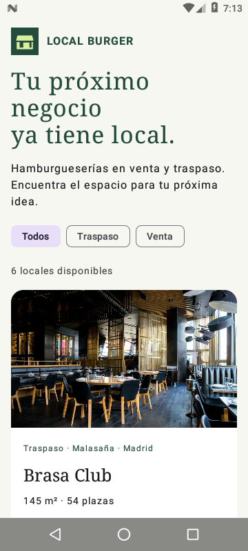
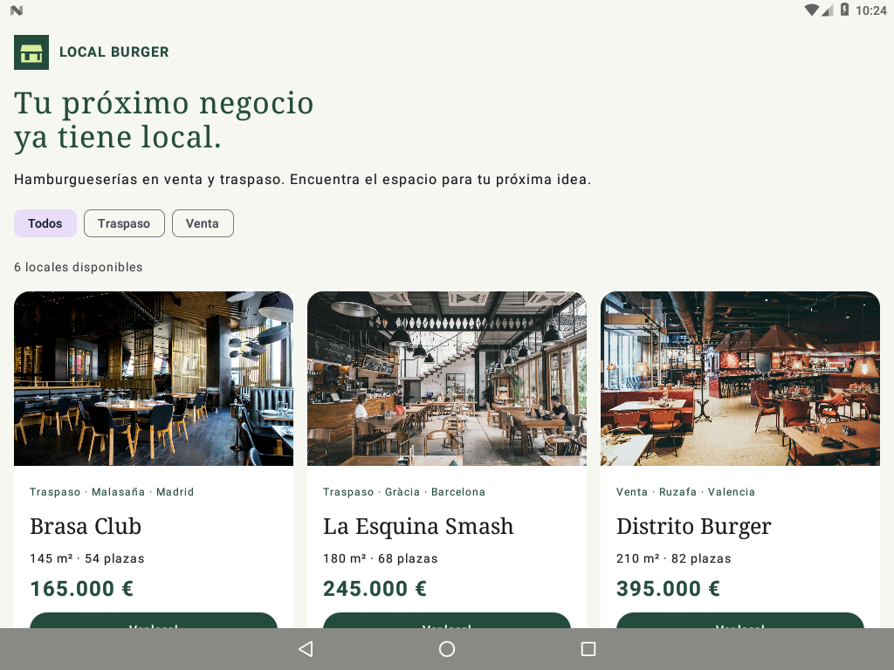
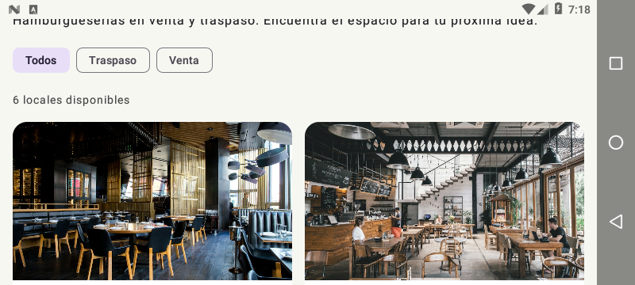

# Local Burger

Aplicación Android para explorar hamburgueserías en venta y traspaso.
El catálogo reúne seis negocios ficticios con fotografías ilustrativas,
ubicación, superficie, número de plazas y precio en euros.

En una venta se incluye el inmueble y el negocio equipado. En un traspaso se
incluyen el negocio y el equipamiento, mientras el inmueble continúa en alquiler.
Las compras son simuladas y no se realizan pagos.

## Funcionalidades

- Pantalla de carga inicial de 1,5 segundos.
- Catálogo con filtros «Todos», «Traspaso» y «Venta» y contador de resultados.
- Ficha de cada local con descripción y condiciones de la operación.
- Simulación de compra con confirmación.
- Cuadrícula adaptable: una columna en móvil vertical y varias cuando hay espacio.
- Conservación del filtro y de la selección al girar el dispositivo.
- Funcionamiento sin conexión, con datos e imágenes incluidos en la aplicación.

## Tecnología

Kotlin y Jetpack Compose con Material 3. El catálogo utiliza `LazyVerticalGrid`
con columnas adaptables de un mínimo de 250 dp. Las fotografías mantienen sus
proporciones mediante recorte y los nombres largos se muestran con puntos suspensivos.

## Ejecutar

Desde la raíz del proyecto, abrir Android Studio con JDK 17 y Android SDK 35.
Seleccionar el módulo `reto2-locales` y ejecutar en un dispositivo o emulador
con Android 7.0 (API 24) o superior.

Para compilar y comprobar el código:

```sh
./gradlew :reto2-locales:assembleDebug
./gradlew :reto2-locales:lintDebug
```

La APK se genera en `reto2-locales/build/outputs/apk/debug/reto2-locales-debug.apk`.

También se puede [descargar la APK](https://sandbox.yerson.co/pmdm/local-burger.apk)
o abrir la aplicación en el [emulador desde el navegador](https://sandbox.yerson.co/pmdm/emulador/).
El emulador requiere credenciales de acceso.

## Capturas

Capturas de la misma APK en dos dispositivos virtuales con Android 7.0 (API 24):
un móvil de 360 × 800 px y una tablet de 1024 × 768 px, ambos a 160 dpi.
La aplicación calcula las columnas con el mismo código en los dos emuladores.

Móvil vertical con una columna:



Tablet con tres columnas:



Como comprobación adicional, móvil horizontal con dos columnas:



## Reflexión crítica

1. **¿Por qué usar `GridCells.Adaptive` en lugar de `GridCells.Fixed(2)`?**
   El número de columnas se calcula según el ancho disponible y el mínimo de
   250 dp por tarjeta. Así, el móvil muestra una columna y la tablet aprovecha
   el espacio con varias, sin comprimir las tarjetas en pantallas pequeñas.

2. **¿Qué sucede si algunos nombres ocupan más líneas que otros?**
   Las tarjetas pueden tener alturas diferentes y sus precios y botones quedan
   desalineados. Limitamos los nombres a una línea con `maxLines = 1` y
   `TextOverflow.Ellipsis`; el nombre completo se puede consultar en la ficha.

3. **¿Por qué usar `ContentScale.Crop` al cambiar el ancho de las tarjetas?**
   Permite llenar el espacio de la imagen conservando sus proporciones, sin
   estirarla al girar el dispositivo o cambiar de pantalla. A cambio, se recortan
   los bordes que no caben en el marco.

4. **¿Qué haría falta para mostrar locales reales de internet?**
   Una API conectada a una base de datos de anuncios, carga de datos e imágenes
   por red y estados de carga, error y catálogo vacío. También habría que
   mantener actualizados los precios y la disponibilidad; las compras reales
   necesitarían autenticación y un proceso de contratación.

## Estructura

- `src/main/java/com/unknowncoder05/localburger/Catalog.kt`: modelo y catálogo de locales.
- `src/main/java/com/unknowncoder05/localburger/MainActivity.kt`: pantalla de carga, catálogo y diálogos.
- `src/main/res/drawable-nodpi/`: fotografías de los locales.
- `img/capturas/`: capturas de la aplicación.
