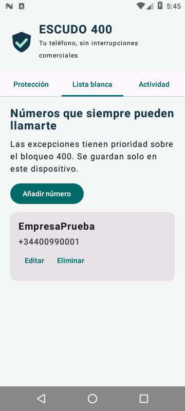
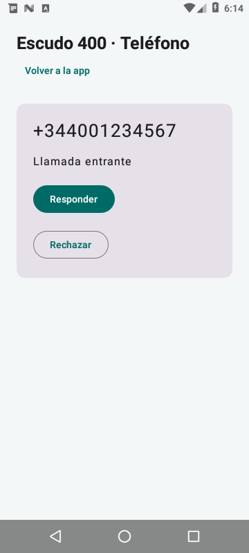

# Reto 3 · Escudo 400

Aplicación Android para bloquear llamadas entrantes del rango comercial español
400 y gestionar una lista blanca de números permitidos. Usa Kotlin, Jetpack
Compose y las API de telefonía de Android, con almacenamiento local en SQLite.

## Funcionalidades

- Rechazo de llamadas de nueve cifras que empiezan por `400`.
- Reconocimiento del mismo número en formato nacional, `+34` y `0034`.
- Lista blanca con creación, consulta, edición y eliminación con confirmación.
- Validación de teléfonos y detección de duplicados aunque tengan formatos distintos.
- Interruptor para pausar y reanudar el bloqueo.
- Actividad con las últimas 100 llamadas filtradas y el motivo de cada decisión.
- Controles para responder, rechazar y colgar las llamadas permitidas en Android 7–9.
- Funcionamiento sin internet, servidores ni suscripciones.

Los números de la lista blanca tienen prioridad sobre el bloqueo. El filtro
compara el número completo: no bloquea un teléfono por acabar en 400 ni por
contener esos dígitos en medio.
Durante una llamada, **Volver a la app** permite consultar la protección y editar
la lista blanca sin colgar. **Volver a la llamada** recupera sus controles.

| Número entrante | Lista blanca | Resultado con protección activa |
| --- | --- | --- |
| `400123456` | No | Bloqueado |
| `+34 400 123 456` | No | Bloqueado |
| `0034 400 123 456` | No | Bloqueado |
| `400123456` | Sí | Permitido |
| `600123400` | No | Permitido |
| `+14001234567` | No | Permitido |

## Activar el bloqueo

1. Abrir Escudo 400 y pulsar **Activar protección**.
2. Aceptar la selección en la pantalla de Android:
   - **Android 7–9:** seleccionar Escudo 400 como aplicación de teléfono.
   - **Android 10 o superior:** seleccionar Escudo 400 como aplicación de filtrado.
3. Mantener activado **Bloquear números 400**.
4. Para incluir también números guardados en la agenda, pulsar
   **Incluir contactos en el filtro** y conceder el permiso. Sin él, Android puede
   permitir los contactos sin entregarlos al servicio de filtrado.

El estado **Protección activa** requiere que Android haya seleccionado la app.
Cerrar su pantalla no desactiva el filtro: Android llama a `CallScreeningService`
cuando necesita evaluar una llamada. No se mantiene un proceso de sondeo.
Las llamadas ocultas y las que Android no entrega al servicio no se evalúan.
El filtro solo cubre llamadas telefónicas, no llamadas de WhatsApp u otras apps.

## Lista blanca

En **Lista blanca**, pulsar **Añadir número**, escribir nombre y teléfono y guardar.
Los teléfonos españoles admiten nueve cifras; los internacionales requieren el
código de país con `+` o `00`. **Editar** permite cambiar ambos campos y
**Eliminar** solicita confirmación. Los cambios se conservan al cerrar la app.

Al eliminar una excepción del rango 400, sus siguientes llamadas vuelven a
bloquearse si la protección sigue activa.

## Ejecutar

Abrir la raíz del repositorio en Android Studio con JDK 17 y Android SDK 35.
Seleccionar `reto3-escudo400` y ejecutar en Android 7.0 (API 24) o superior.

```sh
./gradlew :reto3-escudo400:assembleDebug
./gradlew :reto3-escudo400:testDebugUnitTest :reto3-escudo400:lintDebug
./gradlew :reto3-escudo400:connectedDebugAndroidTest
```

La última orden requiere un dispositivo conectado. La APK se genera en
`reto3-escudo400/build/outputs/apk/debug/reto3-escudo400-debug.apk`.

[Descargar APK](https://sandbox.yerson.co/pmdm/escudo400.apk) ·
[Abrir el emulador](https://sandbox.yerson.co/pmdm/emulador/)

El emulador requiere las credenciales existentes y ejecuta la APK Android real.
Se reutiliza el dispositivo del Reto 2, cuya app queda detenida.

## Capturas

Lista blanca durante la prueba de alta de un número ficticio:



Controles de una llamada admitida durante las pruebas, con acceso para volver a la app:



## Pruebas

Verificados en Android 7: rechazo de una llamada 400, permiso de ese mismo
número tras añadirlo a la lista blanca, respuesta y finalización desde la app.
La compilación, las cinco pruebas unitarias y el análisis lint pasan sin errores.

Las pruebas unitarias cubren los formatos de teléfono, la prioridad de las
excepciones, la pausa del filtro y los números que deben permitirse.
La prueba instrumentada disponible comprueba el CRUD en SQLite, los duplicados y la
persistencia al cerrar y reabrir la base de datos.

Desde el navegador, abrir **… → Phone**, escribir el número en **From** y pulsar
**Call device**. Para regresar al teléfono, cerrar la ventana **Extended Controls**
con su X. La pantalla de llamada incluye **Volver a la app**.

Para introducir una llamada en el emulador, con el filtro activado:

```sh
adb -s emulator-5580 emu gsm call 400123456
adb -s emulator-5580 emu gsm list
```

Debe rechazarse. Si se añade `400123456` a la lista blanca, la siguiente llamada
de ese número debe permanecer entrante y poder responderse. Se puede finalizar
una llamada permitida desde la app o desde la consola:

```sh
adb -s emulator-5580 emu gsm cancel 400123456
```

Estas llamadas se introducen en la telefonía del emulador y no llaman a teléfonos
reales. La comprobación en el emulador usa Android 7; la activación mediante el
rol de Android 10 o superior necesita verificarse también en un dispositivo de
esa versión antes de distribuir la app.

## Estructura

- `CallPolicy.kt`: normalización y reglas de bloqueo.
- `CallStore.kt`: lista blanca y actividad en SQLite.
- `MarketingScreeningService.kt`: respuesta de bloqueo o permiso a Android.
- `MainActivity.kt`: protección, CRUD y actividad.
- `PhoneService.kt`: interfaz de llamadas para Android 7–9.
